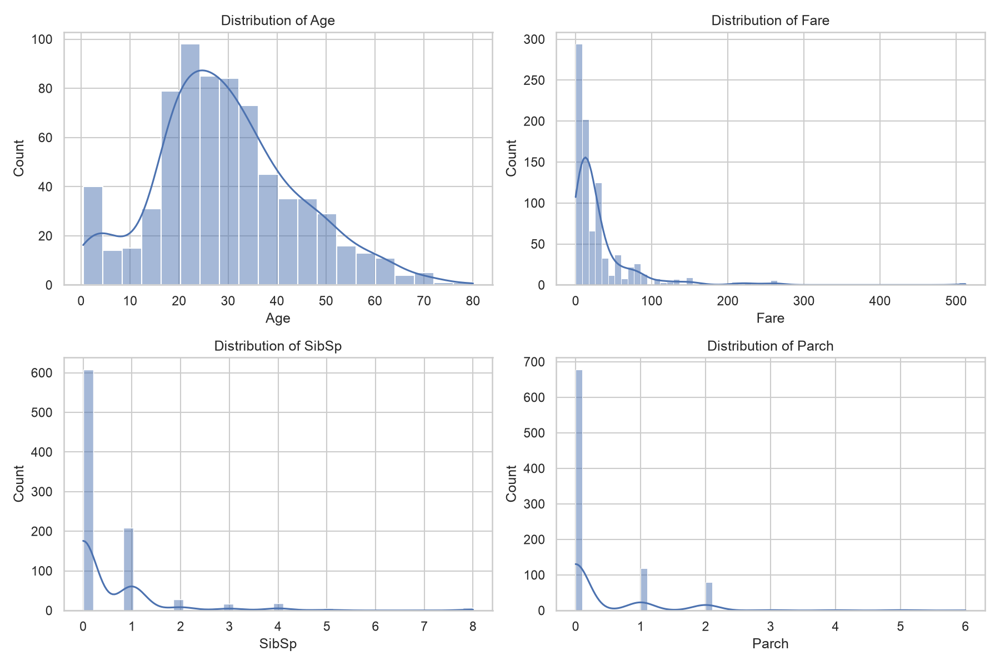
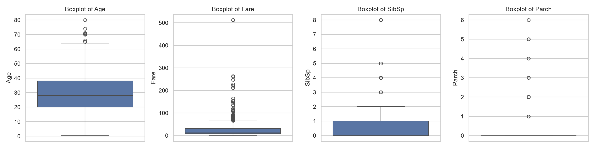
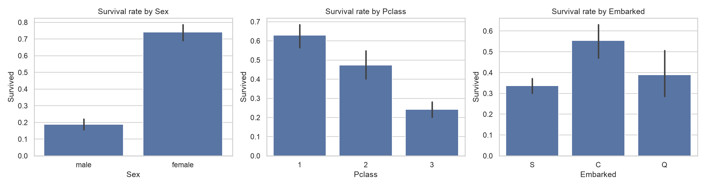
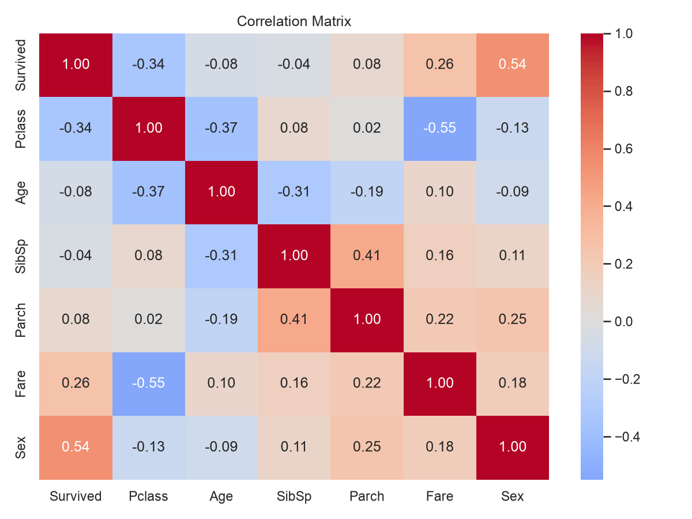
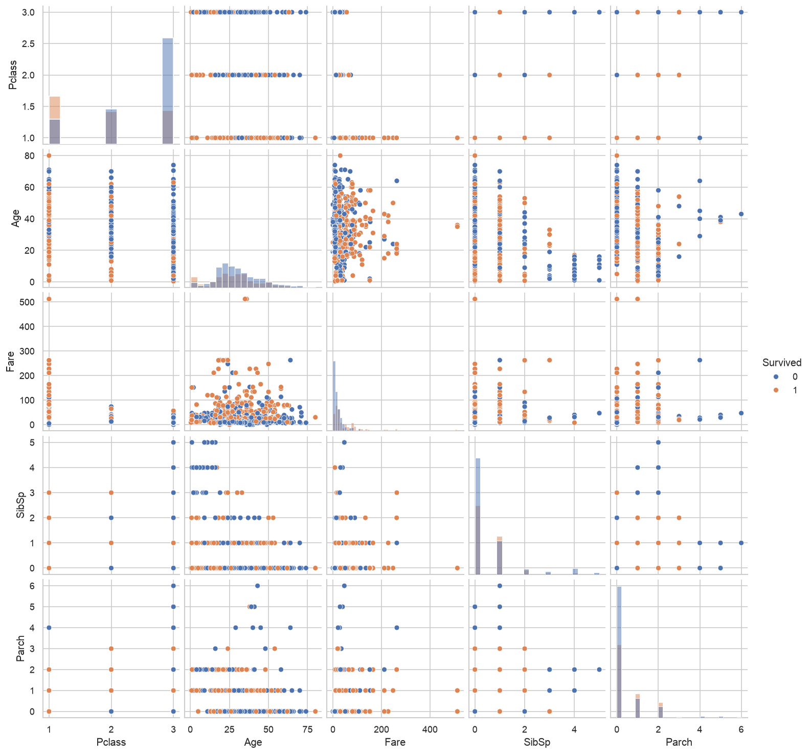

# Task 2: Exploratory Data Analysis (EDA) on the Titanic Dataset

**Elevate Labs AIML Internship, Task 2**

## Objective
Understand the data using statistics and visualizations before building any model. EDA helps us see how each feature is distributed, how features relate to each other and to the target (`Survived`), and where the problems and patterns are.

## Tools Used
Python 3.11, Pandas, NumPy, Matplotlib, Seaborn, Plotly, Jupyter Notebook (in VS Code)

## Dataset
Titanic dataset (`data/Titanic-Dataset.csv`): 891 passengers and 12 columns. The **raw** data is used on purpose, because EDA is about understanding the data as it is, not cleaning it (that was Task 1).

## Project Structure
```
Elevate-labs-aiml-task-2-eda/
├── data/
│   └── Titanic-Dataset.csv
├── images/
│   ├── histograms.png
│   ├── boxplots.png
│   ├── survival_by_category.png
│   ├── correlation_heatmap.png
│   ├── pairplot.png
│   ├── age_by_survival.html        # interactive Plotly chart
│   └── age_vs_fare.html            # interactive Plotly chart
├── task2_eda.ipynb                 # main notebook
├── .gitignore
└── README.md
```

## How to Run
```bash
git clone <this-repo-url>
cd Elevate-labs-aiml-task-2-eda
python3 -m venv venv
source venv/bin/activate
pip install pandas numpy matplotlib seaborn plotly nbformat ipykernel
```
Open `task2_eda.ipynb` in VS Code (or Jupyter), select the `venv` kernel, and run all cells from top to bottom. The `.html` files in `images/` are interactive Plotly charts and can be opened in any browser.

---

## Steps Performed (with line-by-line explanation)

### Step 1: Load the data and get an overview

```python
import pandas as pd
import numpy as np
import matplotlib.pyplot as plt
import seaborn as sns
import plotly.express as px

sns.set_theme(style="whitegrid")

df = pd.read_csv("data/Titanic-Dataset.csv")
print("Shape:", df.shape)
df.head()
```
- `import pandas as pd`: loads Pandas for working with tables (DataFrames).
- `import numpy as np`: loads NumPy for numerical operations.
- `import matplotlib.pyplot as plt`: loads Matplotlib's plotting interface.
- `import seaborn as sns`: loads Seaborn, which builds attractive statistical plots on top of Matplotlib.
- `import plotly.express as px`: loads Plotly Express, used for quick **interactive** charts.
- `sns.set_theme(style="whitegrid")`: sets one clean look (white background with light grid lines) for all Seaborn/Matplotlib plots.
- `df = pd.read_csv(...)`: reads the CSV into a DataFrame called `df`.
- `print("Shape:", df.shape)`: prints (rows, columns), which is 891 rows and 12 columns.
- `df.head()`: shows the first 5 rows to see what the columns look like.

```python
df.info()
print(df.isnull().sum())
```
- `df.info()`: lists every column with its non-null count and data type.
- `df.isnull().sum()`: counts missing values per column. `Age`, `Cabin` and `Embarked` have gaps, and `Cabin` is mostly empty.

---

### Step 2: Summary statistics (Hint 1)

```python
df.describe()
```
- `df.describe()`: shows count, mean, std, min, quartiles (25%, 50%, 75%) and max for every numeric column. It gives a quick feel for the scale and spread of each feature.

```python
num_cols = ["Age", "Fare", "SibSp", "Parch"]
stats = df[num_cols].agg(["mean", "median", "std", "min", "max", "skew"]).round(2)
stats
```
- `num_cols = [...]`: the list of continuous or count-type numeric features we want to study.
- `df[num_cols]`: selects only those columns.
- `.agg([...])`: applies several functions to each column at once: average, middle value, spread, smallest, largest, and **skewness** (how lopsided the distribution is).
- `.round(2)`: rounds to 2 decimals.
- `stats`: displays the table. A big gap between mean and median, or a large skew value, signals a skewed feature. `Fare` is strongly right-skewed.

```python
df.describe(include="object")
```
- `include="object"`: tells `describe()` to summarize the **text** columns instead. It shows the count, number of unique values, the most common value (`top`) and how often it appears (`freq`).

```python
for col in ["Survived", "Pclass", "Sex", "Embarked"]:
    print(df[col].value_counts(), "\n")
```
- `for col in [...]`: loops over the categorical columns.
- `df[col].value_counts()`: counts how many rows fall into each category.
- `print(..., "\n")`: prints the counts, with a blank line between columns.

---

### Step 3: Histograms and boxplots (Hint 2)

```python
fig, axes = plt.subplots(2, 2, figsize=(12, 8))
for ax, col in zip(axes.ravel(), num_cols):
    sns.histplot(df[col].dropna(), kde=True, ax=ax)
    ax.set_title(f"Distribution of {col}")
plt.tight_layout()
plt.savefig("images/histograms.png", dpi=150)
plt.show()
```
- `plt.subplots(2, 2, figsize=(12, 8))`: creates a 2×2 grid of plot areas. `fig` is the whole figure, `axes` is the grid, and `figsize` sets the size in inches.
- `axes.ravel()`: flattens the 2×2 grid into a simple list of 4 plot areas.
- `zip(axes.ravel(), num_cols)`: pairs each plot area with a column name so the loop handles them together.
- `df[col].dropna()`: removes missing values, because the plot can't use them (`Age` has nulls).
- `sns.histplot(..., kde=True, ax=ax)`: draws a histogram (bars showing how many values fall in each range). `kde=True` adds a smooth curve showing the overall shape of the distribution.
- `ax.set_title(...)`: gives each plot a title using the column name.
- `plt.tight_layout()`: fixes spacing so labels don't overlap.
- `plt.savefig(..., dpi=150)`: saves the figure as an image for this README (`dpi` controls sharpness).
- `plt.show()`: displays the figure in the notebook.



```python
fig, axes = plt.subplots(1, 4, figsize=(16, 4))
for ax, col in zip(axes, num_cols):
    sns.boxplot(y=df[col], ax=ax)
    ax.set_title(f"Boxplot of {col}")
plt.tight_layout()
plt.savefig("images/boxplots.png", dpi=150)
plt.show()
```
- `plt.subplots(1, 4, ...)`: creates one row with 4 plot areas.
- `sns.boxplot(y=df[col], ax=ax)`: draws a vertical boxplot. The box covers the middle 50% of values, the line inside is the median, the whiskers show the normal range, and dots beyond the whiskers are potential outliers.
- The remaining lines (title, layout, save, show) work exactly like the histogram cell.



---

### Step 4: Categorical features vs survival

```python
fig, axes = plt.subplots(1, 3, figsize=(15, 4))
for ax, col in zip(axes, ["Sex", "Pclass", "Embarked"]):
    sns.barplot(x=col, y="Survived", data=df, ax=ax)
    ax.set_title(f"Survival rate by {col}")
plt.tight_layout()
plt.savefig("images/survival_by_category.png", dpi=150)
plt.show()
```
- `plt.subplots(1, 3, ...)`: three side-by-side plot areas, one per categorical feature.
- `sns.barplot(x=col, y="Survived", data=df, ax=ax)`: because `Survived` is 0/1, the average of each bar is the **survival rate** of that group. The thin black line on each bar is a confidence interval showing uncertainty.
- The title, layout, save and show lines work as before.



```python
for col in ["Sex", "Pclass", "Embarked"]:
    print(df.groupby(col)["Survived"].mean().round(2), "\n")
```
- `df.groupby(col)`: splits the data into groups, one per category.
- `["Survived"].mean()`: the average of `Survived` in each group, which is the survival rate as a number.
- `.round(2)`: two decimals. This gives the exact numbers behind the bar charts.

---

### Step 5: Correlation matrix and pairplot (Hint 3)

```python
df_corr = df[["Survived", "Pclass", "Age", "SibSp", "Parch", "Fare"]].copy()
df_corr["Sex"] = df["Sex"].map({"male": 0, "female": 1})
corr = df_corr.corr()

plt.figure(figsize=(8, 6))
sns.heatmap(corr, annot=True, fmt=".2f", cmap="coolwarm", center=0)
plt.title("Correlation Matrix")
plt.tight_layout()
plt.savefig("images/correlation_heatmap.png", dpi=150)
plt.show()
```
- `df[[...]].copy()`: picks the numeric columns and makes an independent copy, so the original `df` stays untouched.
- `df["Sex"].map({"male": 0, "female": 1})`: converts text to numbers, because correlation only works on numbers. The result is stored in the copy.
- `df_corr.corr()`: computes the correlation between every pair of columns. Values go from −1 (perfect negative) through 0 (no linear relationship) to +1 (perfect positive).
- `plt.figure(figsize=(8, 6))`: creates a blank figure of that size.
- `sns.heatmap(corr, ...)`: draws the correlation table as a colored grid. `annot=True` writes the number in each cell, `fmt=".2f"` shows 2 decimals, `cmap="coolwarm"` uses red for positive and blue for negative, and `center=0` makes zero the neutral color.
- `plt.title(...)`, `tight_layout()`, `savefig(...)`, `show()`: label, tidy, save and display the plot.



```python
pair_df = df[["Survived", "Pclass", "Age", "Fare", "SibSp", "Parch"]].dropna()
g = sns.pairplot(pair_df, hue="Survived", diag_kind="hist")
g.savefig("images/pairplot.png", dpi=120)
plt.show()
```
- `.dropna()`: removes rows with missing values so every plot gets clean data.
- `sns.pairplot(pair_df, hue="Survived", ...)`: draws a grid of scatter plots for every pair of features, so you can see relationships at a glance. `hue="Survived"` colors the points by survival, and `diag_kind="hist"` puts a histogram on the diagonal for each feature.
- `g.savefig(...)`: saves the pairplot (a pairplot object has its own `savefig`).
- `plt.show()`: displays it.



---

### Step 6: Patterns, trends and anomalies (Hint 4)

```python
df["AgeGroup"] = pd.cut(df["Age"], bins=[0, 12, 18, 35, 60, 100],
                        labels=["Child", "Teen", "Young Adult", "Adult", "Senior"])
print(df.groupby("AgeGroup", observed=True)["Survived"].mean().round(2))
```
- `pd.cut(df["Age"], bins=[...], labels=[...])`: sorts ages into ranges (0–12, 12–18, 18–35, 35–60, 60–100) and names each range. The result is stored in a new column `AgeGroup`.
- `df.groupby("AgeGroup", observed=True)`: groups by those ranges (`observed=True` just avoids a Pandas warning about unused categories).
- `["Survived"].mean().round(2)`: the survival rate per age group, which shows whether age affects survival.

```python
print(df["Fare"].nlargest(5))
print("Zero-fare passengers:", (df["Fare"] == 0).sum())
df[df["Fare"] > 300]
```
- `df["Fare"].nlargest(5)`: shows the 5 highest fares, to inspect the extreme values.
- `(df["Fare"] == 0)`: gives True/False for each passenger with a free ticket, and `.sum()` counts them, which flags a possible anomaly.
- `df[df["Fare"] > 300]`: filters and shows the full rows of passengers who paid extremely high fares.

```python
print(df.groupby("Pclass")["Age"].apply(lambda s: s.isnull().mean()).round(2))
```
- `df.groupby("Pclass")["Age"]`: takes the Age column separately for each class.
- `.apply(lambda s: s.isnull().mean())`: for each class, calculates the **fraction of missing ages**. `isnull()` marks missing values and `mean()` turns that into a proportion.
- `.round(2)`: two decimals. This checks whether missing ages are random or concentrated in one class.

```python
df["Survived_label"] = df["Survived"].map({0: "No", 1: "Yes"})

fig = px.histogram(df, x="Age", color="Survived_label", barmode="overlay",
                   nbins=30, title="Age distribution by survival")
fig.show()
fig.write_html("images/age_by_survival.html")
```
- `df["Survived"].map({0: "No", 1: "Yes"})`: creates a readable text label, so Plotly treats it as two categories and not a number scale.
- `px.histogram(...)`: an interactive histogram of `Age`. `color=` splits the bars by survival, `barmode="overlay"` draws the two groups on top of each other (semi-transparent), and `nbins=30` sets the number of bars.
- `fig.show()`: displays the interactive chart in the notebook (hover for values, click the legend to hide a group).
- `fig.write_html(...)`: saves the chart as a standalone web page that can be opened in any browser.

```python
fig2 = px.scatter(df, x="Age", y="Fare", color="Survived_label", symbol="Sex",
                  hover_data=["Pclass"], title="Age vs Fare")
fig2.show()
fig2.write_html("images/age_vs_fare.html")
```
- `px.scatter(...)`: an interactive scatter plot with `Age` on the x-axis and `Fare` on the y-axis.
- `color="Survived_label"`: colors points by survival.
- `symbol="Sex"`: uses a different marker shape for each sex.
- `hover_data=["Pclass"]`: also shows the passenger's class when hovering.
- `fig2.show()` and `fig2.write_html(...)`: display and save, as above.

> **Note:** GitHub's notebook preview often doesn't display Plotly charts, so the key plots are also saved as PNGs with Seaborn, and the Plotly charts are saved as `.html` files in `images/`.

---

### Step 7: Inferences from the visuals (Hint 5)

> Based on the outputs in the notebook (confirm these against your own numbers):

1. **Sex is the strongest factor.** Women survived at a much higher rate (roughly 3 out of 4) than men (roughly 1 out of 5).
2. **Passenger class matters.** Survival falls from 1st to 2nd to 3rd class, and `Pclass` is negatively correlated with `Survived`.
3. **`Fare` is heavily right-skewed.** Most tickets are cheap while a few are extremely expensive. `Fare` and `Pclass` are negatively correlated, since higher classes paid more.
4. **Age:** the distribution is roughly bell-shaped with a peak in the 20s to 30s, and children had a higher survival rate than most other age groups.
5. **Family size:** `SibSp` and `Parch` are small counts with a few large families, and they show weak correlation with survival.
6. **Data quality issues:** `Age` has missing values, `Cabin` is mostly missing, and some passengers have a fare of 0 (possible anomalies). These need handling before modeling (see Task 1).
7. **Multicollinearity check:** the strongest correlation between predictors is `Pclass` and `Fare`, which is something to watch when building linear models.

---

## What I Learned
- How to summarize a dataset with descriptive statistics, including skewness
- Reading histograms, boxplots, heatmaps and pairplots
- Using group-by survival rates to find the features that matter
- Spotting anomalies (extreme and zero fares) and missing-data patterns
- Building interactive charts with Plotly alongside static ones with Seaborn

---

## Interview Questions & Answers

### 1. What is the purpose of EDA?
EDA (Exploratory Data Analysis) is the process of examining a dataset with statistics and visualizations *before* modeling. Its purpose is to understand the structure and distribution of the data, find missing values, outliers and errors, discover patterns and relationships between features, check assumptions, and decide which cleaning, feature engineering and models are appropriate.

### 2. How do boxplots help in understanding a dataset?
A boxplot summarizes a numeric feature using five numbers: minimum, Q1, median, Q3 and maximum. It shows the center (the median line), the spread (the box height, or IQR), the skew (an off-center median or one long whisker) and **outliers** (points beyond the whiskers). Placed side by side, boxplots also compare a feature across groups, such as `Fare` by `Pclass`.

### 3. What is correlation and why is it useful?
Correlation measures the strength and direction of a **linear** relationship between two numeric variables, from −1 (perfect negative) through 0 (none) to +1 (perfect positive). It's useful for finding which features relate to the target (good candidates for a model), spotting features that duplicate each other (redundancy), and guiding feature selection. Remember that correlation does not imply causation, and it can miss non-linear relationships.

### 4. How do you detect skewness in data?
- **Visually:** a histogram or KDE with a long tail on one side. A long right tail means right (positive) skew, and a long left tail means left (negative) skew. Boxplots show it too.
- **Numerically:** `df.skew()` in Pandas. Values near 0 mean roughly symmetric, while values beyond about ±1 mean strongly skewed.
- **Mean vs median:** in right-skewed data the mean is larger than the median.

Skewed features can be fixed with log, square-root or Box-Cox transforms. In this task, `Fare` is strongly right-skewed.

### 5. What is multicollinearity?
Multicollinearity happens when two or more input features are highly correlated with each other, so they carry overlapping information. It makes the coefficients of linear and logistic regression unstable and hard to interpret, even though predictions may remain fine. It's detected with a correlation matrix or the **Variance Inflation Factor (VIF)**, and handled by removing one of the correlated features, combining them, or using PCA or regularization (Ridge/Lasso). Tree-based models are much less affected.

### 6. What tools do you use for EDA?
- **Pandas** for loading, summarizing and grouping data (`describe`, `info`, `groupby`, `value_counts`)
- **NumPy** for numerical work
- **Matplotlib and Seaborn** for static plots (histograms, boxplots, heatmaps, pairplots)
- **Plotly** for interactive charts
- **Jupyter Notebook** for combining code, plots and notes
- Optionally, automated profiling tools such as ydata-profiling and Sweetviz

### 7. Can you explain a time when EDA helped you find a problem?
In this Titanic project, EDA revealed several problems before any modeling. The missing-value count showed that `Cabin` was mostly empty and `Age` had many gaps, so those columns would need special handling. Checking the largest fares and counting zero fares exposed extreme and suspicious values, and the skew statistics showed that `Fare` was heavily right-skewed. The survival-rate-by-group analysis also showed that `Sex` and `Pclass` are dominant predictors, which tells us which features matter most. Without EDA, these issues would have silently hurt a model.

### 8. What is the role of visualization in ML?
Visualization turns raw numbers into patterns people can see. In ML it's used to understand the data (distributions, outliers, relationships), choose features and preprocessing steps, spot problems like imbalance or leakage, diagnose models (learning curves, confusion matrices, ROC curves, feature importance), and communicate results to non-technical stakeholders. Plots often reveal things that summary statistics hide.

---

## Author
**Uzair Riyaz** | [GitHub](https://github.com/uzair1355) | [LinkedIn](https://linkedin.com/in/mohammad--uzair)